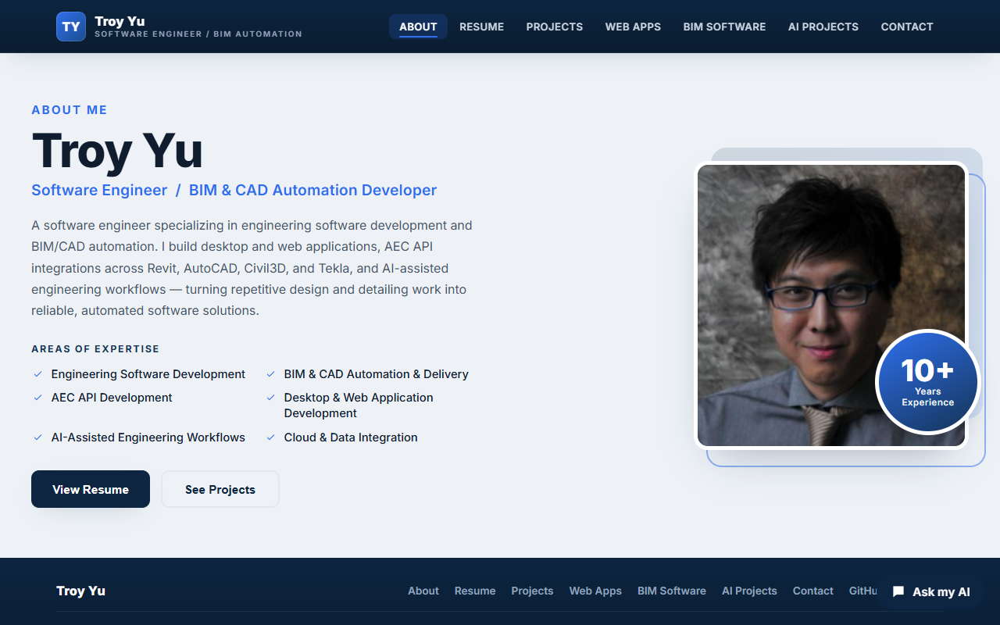

# Troy Yu — Portfolio Website

The personal portfolio and résumé site for **Hao "Troy" Yu**, Software Engineer /
BIM & CAD Automation Developer. It presents professional experience, engineering
(BIM) project work, self-built web apps, BIM desktop software and AI projects,
and a contact route, as a single-page React app — with an **Ask my AI** button
that opens Troy's AI career assistant.

**Live:** <https://troyyu527.github.io/ReactWebsite>



## Pages

| Route | Page | What it shows |
|---|---|---|
| `/` | About Me | Intro, profile, social links |
| `/Resume` | Résumé | Experience, selected technical projects, education, skills — plus a PDF download |
| `/Projects` | BIM Projects | AEC/construction work: LaGuardia, Kosciuszko Bridge, Goethals Bridge, and others, with photo and video galleries |
| `/WebApps` | Web Apps | Self-built software: UNO Multiplayer, VisualAlgo, Hide & Seek |
| `/BIMSoftware` | BIM Software | Windows desktop tools for IFC / openBIM: IFC Viewer, Engineering Model QA |
| `/AIProjects` | AI Projects | LLM and agent projects: AI Career Assistant, BIM AI Agent |
| `/Contact` | Contact | Form that composes a pre-filled email via `mailto:` |

The old `/3Dsample` page (a Three.js viewer) was retired; its link redirects to
`/BIMSoftware`.

Project content is data-driven: every gallery renders from
[`src/projectData.js`](src/projectData.js), so adding a project means adding an
object, not writing a component.

## Tools & technologies

| Area | Used |
|---|---|
| Framework | **React 18** |
| Build tool | **Create React App** (`react-scripts` 5) |
| Routing | **React Router 6** (`BrowserRouter`, `basename` from `PUBLIC_URL`) |
| Styling | SCSS → CSS |
| Deploy | GitHub Pages via `gh-pages` |

## Getting started

```bash
npm install
npm start
```

Then open **<http://localhost:8080>**.

> The port is pinned to `8080` by the `start` script (`set PORT=8080 && ...`).
> That syntax is Windows-specific — on macOS or Linux use `PORT=8080
> react-scripts start`, or install `cross-env`.

## Build & deploy

```bash
npm run build        # production build → build/
npm run deploy       # runs predeploy (build) then publishes build/ to gh-pages
```

`homepage` in `package.json` is set to the GitHub Pages URL, which is what makes
asset paths and the router `basename` resolve correctly under `/ReactWebsite/`.

> **Routing note:** this uses `BrowserRouter`, not `HashRouter`. GitHub Pages has
> no server-side rewrites, so a deep link such as `/ReactWebsite/Resume` would
> 404 on its own. [`public/404.html`](public/404.html) (the
> [spa-github-pages](https://github.com/rafrex/spa-github-pages) shim) turns it
> into a query string that `public/index.html` restores before the app loads.

## Project layout

```
public/
  download/TroyYu_Resume.pdf   downloadable résumé (linked from /Resume)
  img/ , video/                project media for the galleries
src/
  App.js                       routes and layout
  projectData.js               ALL project content (BIM + web apps)
  components/
    Aboutme.jsx                landing page
    Resume.jsx                 résumé content
    Projects.jsx               BIM gallery      (reads projectDataBIM)
    WebApps.jsx                web app gallery  (reads projectDataCS)
    BimSoftware.jsx            BIM software     (reads projectDataBIMSoftware)
    AIProjects.jsx             AI projects      (reads projectDataAI)
    AskMyAI.jsx                "Ask my AI" button → AI career assistant
    Contact.jsx                contact form (mailto)
    Menubar.jsx                navigation
    Slide.jsx / CSlide.jsx     image & content carousels
  css/                         SCSS sources and compiled CSS
  profile/                     photos and icons
TroyYu_Resume_2026.txt         résumé source text (not published — outside public/)
```

## Updating content

- **Projects** — edit [`src/projectData.js`](src/projectData.js).
  `projectDataBIM` feeds `/Projects`, `projectDataCS` feeds `/WebApps`,
  `projectDataBIMSoftware` feeds `/BIMSoftware` and `projectDataAI` feeds
  `/AIProjects`. Image paths are relative to `public/`. Optional fields:
  `status` (a badge such as "In progress"), `linkLabel` (button text instead of
  ENTER), `linkNote` (shown when there's no link) and `backup` (a second link).
- **Résumé (page)** — edit [`src/components/Resume.jsx`](src/components/Resume.jsx).
- **Résumé (PDF)** — regenerate from `TroyYu_Resume_2026.txt` and replace
  `public/download/TroyYu_Resume.pdf`. Keep the two in step; the page and the
  download are separate sources.

## Housekeeping notes

- `npm run build` with `CI=true` treats warnings as errors, so a stray lint
  warning will fail a CI deploy even though a local build passes.
